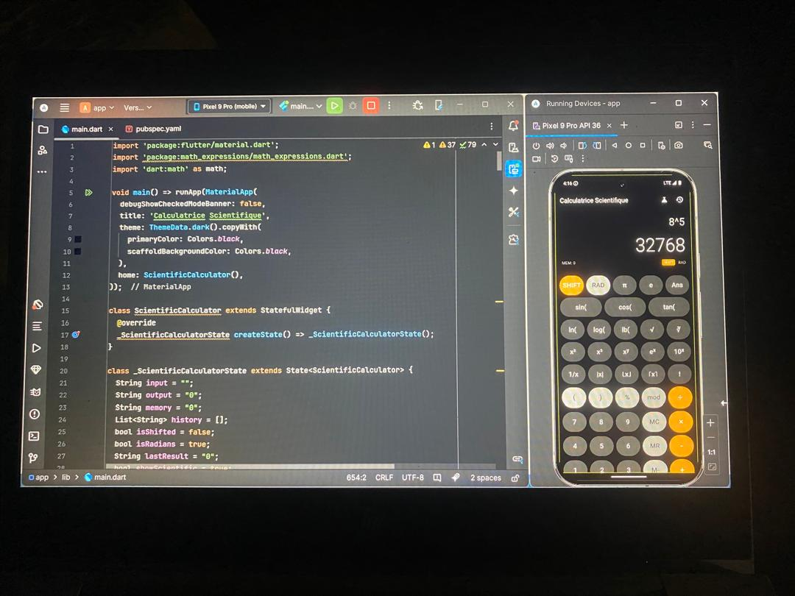

# Calculator App

I developed this project to learn a little more about mobile development and establish the difference between web development and mobile development. It helped me understand the basics of the Dart language and Flutter, a modern mobile app framework.

